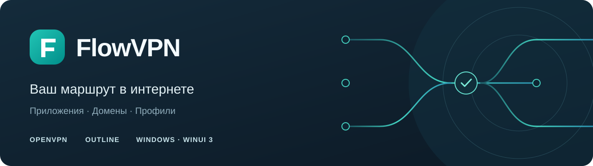

  

  
  
  
  

  <a href="docs/INSTALLATION.md">Установка</a> ·
  <a href="docs/DEVELOPMENT.md">Сборка</a> ·
  <a href="docs/ARCHITECTURE.md">Архитектура</a> ·
  <a href="CONTRIBUTING.md">Участие</a> ·
  <a href="CONTRIBUTORS.md">Участники</a> ·
  <a href="SECURITY.md">Безопасность</a>

# FlowVPN

**Управление маршрутами VPN для Windows.** Выберите приложения и домены, которые должны использовать VPN, объедините их в профили и переключайтесь между подключениями OpenVPN и Outline. Общая база RunetFreedom применяется ко всем профилям и включается отдельно.

FlowVPN — графическое приложение на WinUI 3 с движком [sing-box](https://github.com/SagerNet/sing-box). Для работы нужен ваш сервер и данные подключения: сервис VPN и доступ к серверам проект не предоставляет. Устанавливать OpenVPN Connect или Outline не требуется.

> **Статус:** [FlowVPN 1.5.3 — предварительный выпуск](https://github.com/vserdobintsev/FlowVPN/releases/tag/v1.5.3) для Windows x64. Начните с установочного ZIP на странице выпуска. MSIX содержит рабочий VPN и подписан собственным сертификатом; при первой установке нужно добавить ему доверие. Полная приёмка на чистой Windows и независимый аудит безопасности ещё не завершены. [Проверки и ограничения](docs/VALIDATION-1.5.3.md).

## Что умеет FlowVPN

| Возможность | Как это работает |
| --- | --- |
| **Профили маршрутизации** | Приложения, домены, режим работы и источник подключения объединены в отдельный профиль. Название, значок и цвет доступны сразу при создании, в общей форме с редактированием. |
| **Самостоятельное добавление** | Вставьте ключ или конфигурацию либо выберите файлы: поддерживаемый формат определяется автоматически. Параметры Shadowsocks можно ввести вручную. Перенос из установленных клиентов доступен отдельно. |
| **Дополнительные модули** | Установка и удаление из настроек, общая панель прогресса и отмена загрузки. Модуль совместимости Outline добавляет поддержку ключей с TCP-префиксом. |
| **Выбор приложений** | Каталог с иконками, список запущенных процессов, выбор EXE или папки. Компоненты программы сгруппированы в одну карточку. |
| **Готовые наборы** | Codex, Telegram, браузеры, OpenCode, NVIDIA App и другие программы. Компонент предлагается только после обнаружения на компьютере. |
| **Компоновка наборов** | Объединение, пересечение, разность и симметрическая разность с просмотром результата. Сохранённый состав не зависит от подключения или путей на этом компьютере. |
| **Первичная настройка** | После первого подключения выберите карточки готовых профилей или отложите создание. Наборы учитывают доступные программы и остаются доступны позже. |
| **Расширения приложений** | Общая иерархия «приложение → расширение → компоненты»; в каталоге есть Codex и Kilo Code для поддерживаемых редакторов. |
| **Общая база** | IP-правила, основной доменный список и несколько дополнительных категорий RunetFreedom действуют во всех профилях. Поиск, множественный выбор и проверяемый кэш упрощают настройку. [Как устроен выбор](docs/BASE-RULES.md). |
| **Интеграция с Windows** | Меню трея, команда подключения в превью панели задач, светлая и тёмная темы, настраиваемый автозапуск интерфейса. Боковая панель расширяется на широком экране; в небольшом окне остаются значки профилей. |
| **Наблюдение за подключением** | Состояние движка, статистика и соединения через локальный API sing-box, журнал выбранного профиля. |
| **Графики трафика** | Приём и отправка в реальном времени, интервалы 1/5/15 минут, пауза просмотра, поиск и группировка активных соединений. История ограничена и хранится только в памяти. [Что именно измеряется](docs/TRAFFIC.md). |

## Как выбирается маршрут

Сначала применяются общие правила. Если общая база включена и адрес в неё входит, трафик направляется через VPN — в том числе для приложения, добавленного в исключения. Затем учитываются дополнительные домены и режим профиля.

| Режим профиля | Выбранные приложения | Остальной трафик |
| --- | --- | --- |
| Только выбранные приложения | Через VPN | Напрямую |
| Все, кроме выбранных | Напрямую | Через VPN |
| Весь трафик | Через VPN | Через VPN |

Таблица описывает правила приложений; общая база, дополнительные домены и локальные адреса имеют собственный порядок обработки. Подробная схема — в [описании архитектуры](docs/ARCHITECTURE.md#порядок-маршрутизации).

Подключение и режим профиля сохраняются при выборе. Создание профиля и изменение оформления подтверждаются в форме; домены — кнопкой «Сохранить». Для состава общей базы предусмотрено явное применение после проверки правил. Сетевые правила применяются при следующем подключении.

## Начало работы

Для установки подготовлены MSIX и небольшой установочный комплект. **sing-box, .NET и Windows App SDK входят в пакет** — отдельно устанавливать их не требуется.

1. Получите полный установочный комплект MSIX и распакуйте его. Пока публичный выпуск приложения не опубликован, пакет можно [собрать из исходников](docs/DEVELOPMENT.md). Релиз модуля Outline не содержит установщик FlowVPN.
2. Запустите `Install-FlowVPN.cmd`. При первой установке подтвердите доверие собственному сертификату FlowVPN; установщик отдельно запросит UAC.
3. Откройте приложение из меню «Пуск» и нажмите «Добавить подключение». Вставьте полученные от провайдера данные или выберите файл, затем настройте профиль и нажмите «Подключить».

Приложение устанавливается для текущего пользователя. Административные права нужны для добавления доверия сертификату и для подключения VPN. Автозапуск интерфейса включается по желанию и не подключает VPN автоматически.

[Полная инструкция](docs/INSTALLATION.md) · [Перенос прежних настроек](docs/INSTALLATION.md#перенос-настроек) · [Сборка из исходников](docs/DEVELOPMENT.md)

### Требования

| | Требование |
| --- | --- |
| Система | Windows x64; в манифесте заявлена Windows 10 build 19041 и новее. Проверки на всех версиях ОС ещё не завершены. |
| Подключение | Собственный сервер или совместимая конфигурация OpenVPN/Outline. |
| Установка | Штатный Windows PowerShell 5.1; возможность подтвердить запрос UAC. |
| Разработка | Windows x64, PowerShell 7 и .NET SDK из [`global.json`](global.json). |

## Границы текущей версии

- **Kill switch не реализован.** Обнаружение обрыва связи не гарантирует блокировку прямого трафика. Испытания IPv4/IPv6, DNS, QUIC, сна и смены адаптеров ещё нужны.
- **Права запрашивает отдельный процесс управления VPN.** Интерфейс остаётся обычным процессом; настоящий цикл UAC/TUN установленного MSIX ещё требует приёмки.
- **Импорт OpenVPN поддерживает ограниченный набор параметров.** Несовместимые настройки отклоняются; скрипты и плагины из конфигурации не исполняются.
- **Расширенные конфигурации Outline поддерживаются не полностью.** Для TCP-префикса обычных ключей и JSON нужен [дополнительный модуль](docs/MODULES.md). Расширенный `transport`, плагины и неподдерживаемые методы отклоняются; их параметры не отбрасываются.
- **Общий процесс нельзя разделить по расширениям.** Если запросы нескольких расширений выполняет один процесс приложения, правило затронет этот процесс целиком.
- **Подпись собственным сертификатом требует явного доверия.** Она подтверждает целостность и принадлежность ключу, но не является независимой проверкой издателя.

Границы защиты, хранение секретов и порядок сообщения об уязвимости описаны в [SECURITY.md](SECURITY.md).

## Документация и участие

| Задача | Документ |
| --- | --- |
| Установить приложение, перенести настройки, разобраться с сертификатом | [Установка](docs/INSTALLATION.md) |
| Собрать MSIX и запустить изолированные проверки | [Разработка](docs/DEVELOPMENT.md) |
| Понять профили, компоненты, правила и работу движка | [Архитектура](docs/ARCHITECTURE.md) |
| Подготовить подписанный выпуск и канал обновлений | [Выпуск версии](docs/RELEASING.md) |
| Заменить потерянный или скомпрометированный ключ | [Восстановление подписи](src/FlowVPN.WinUI/Distribution/SIGNING-RECOVERY.md) |
| Предложить изменение или отправить pull request | [Правила участия](CONTRIBUTING.md) |
| Сообщить об ошибке или получить помощь | [Поддержка](SUPPORT.md) |
| Посмотреть изменения | [История изменений](CHANGELOG.md) |
| Узнать, что проверено в выпуске 1.5.3 | [Проверки версии 1.5.3](docs/VALIDATION-1.5.3.md) |

Документация и обсуждения проекта ведутся на русском. Коммиты и заголовки pull request — на английском по Conventional Commits; имена веток — также на английском. Конкретные правила и проверки описаны в [CONTRIBUTING.md](CONTRIBUTING.md).

## Автор и лицензия

**Владислав Сердобинцев** · [GitHub](https://github.com/vserdobintsev) · [vladislav.serdobintsev@gmail.com](mailto:vladislav.serdobintsev@gmail.com)

Собственный код FlowVPN распространяется под **GPL-3.0-only**. Полный текст — в [LICENSE](LICENSE), сведения о sing-box, Microsoft SDK и источниках правил — в [THIRD-PARTY-NOTICES.md](THIRD-PARTY-NOTICES.md).

FlowVPN использует независимые проекты [sing-box](https://github.com/SagerNet/sing-box), [RunetFreedom GeoIP](https://github.com/runetfreedom/russia-blocked-geoip) и [RunetFreedom GeoSite](https://github.com/runetfreedom/russia-blocked-geosite). Названия поддерживаемых приложений принадлежат их владельцам.
