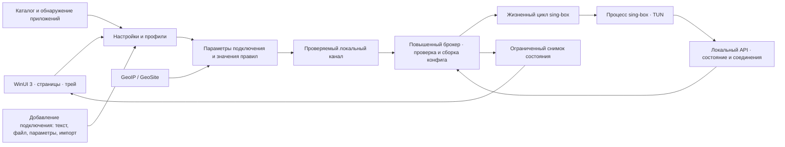
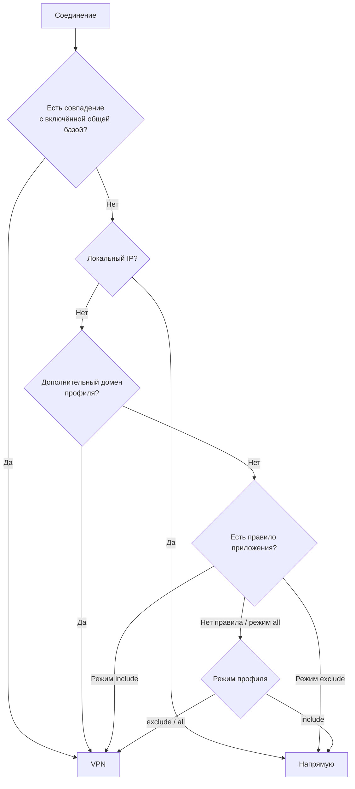

# Архитектура FlowVPN

[← К README](../README.md) · [Разработка](DEVELOPMENT.md) · [Безопасность](../SECURITY.md)

FlowVPN хранит источники подключения и профили, строит конфигурацию sing-box и управляет его жизненным циклом. Сетевой трафик обрабатывает отдельный процесс sing-box; интерфейс написан на WinUI 3.

## Основные границы

| Область | Ответственность |
| --- | --- |
| `Core/Models.cs` | Сохранённые настройки, профили, пути данных и защищённое хранилище |
| `Core/Networking.cs` | Сетевая диагностика, базы и клиент управления сеансом |
| `Broker/` | Контракт IPC, проверка обеих сторон, сборка допустимой конфигурации и владение повышенным движком |
| Каталог `AppPresets.json` и классы обнаружения | Данные о программах, проверка наличия компонентов и предложение правил |
| `FluentWindow` и файлы страниц | Представление, взаимодействие, состояния интерфейса |
| `UpdateProtocol` / `UpdateTransport` | Проверка метаданных обновлений и ограниченные загрузки |
| `UpdatesPage` | Интерфейс обновлений и обращение к Windows Deployment API |
| `Distribution/` | Подготовка движка, проверка пакета, установка и метаданные выпуска |

Windows Forms используется для `NotifyIcon` и отдельных системных диалогов. Основной интерфейс — WinUI 3; второго интерфейса на WinForms в проекте нет.

## Источники, профили и общие настройки

**Источник подключения** содержит параметры OpenVPN или Outline. Источники доступны всему приложению. Профиль ссылается на источник по идентификатору, а не хранит свою независимую копию учётных данных.

`ConnectionInput` определяет формат по содержимому без сетевых запросов; `Importers` проверяет параметры и создаёт единый источник. Вставка текста, чтение файла, ручные параметры Shadowsocks и перенос из клиента сходятся в этой модели. Ручной Shadowsocks сохраняет существующий внутренний `Kind = "Outline"` для совместимости настроек и брокера. Установленные сторонние клиенты не являются зависимостью основного сценария.

`PresetProfileFactory` формирует предложения по обнаруженным компонентам, но не создаёт профили при импорте подключения. Пользователь выбирает карточки и источник в отдельном шаге настройки. Перед созданием наличие компонентов проверяется повторно; каждое правило копируется в новый профиль. Пропуск шага сохраняется в настройках, а повторное открытие доступно явно. Необязательные общие процессы приложения-хоста не включаются в рекомендуемый набор молча.

Пользовательский набор приложений хранит плоский список идентификаторов каталога: без локальных путей, ссылки на VPN-сервер и зависимости от исходных наборов. Операции множеств выполняются над этими идентификаторами. При создании профиля каталог заново разрешается в доступные рекомендуемые компоненты; неполные наборы не превращаются в незаметно урезанные профили. База блокировок находится вне алгебры наборов.

**Профиль** содержит имя и оформление, выбранные приложения, дополнительные домены и режим маршрутизации. Профили могут использовать один источник, сохраняя разные наборы правил.

**Общая база** включает GeoIP и выбранную категорию GeoSite RunetFreedom. Её состояние и категория общие для всех профилей. Выключение базы не удаляет дополнительные правила профиля.

Настройки сохраняются сразу. Конфигурация движка строится при подключении: изменение правила в интерфейсе не означает немедленную перестройку активного туннеля.

## Порядок маршрутизации

Упрощённая схема для пользовательского трафика после служебной обработки:

Реальный конфиг сначала обрабатывает локальный вход менеджера, определение протокола и DNS. Затем идут GeoIP и доменная база, локальные IP, дополнительные домены, правила процессов и завершающий маршрут режима. Схема не является описанием всех DNS-правил.

Это задаёт явные приоритеты:

- Общая база имеет приоритет над исключениями приложений.
- Дополнительный домен направляется через VPN независимо от списка приложений, если более раннее правило уже не определило маршрут.
- Локальные IP обрабатываются напрямую после проверки базы.
- В режиме `all` список приложений не меняет завершающий маршрут.

Удаляются только доказанно избыточные дополнительные доменные правила. Наличие exact- или regex-правила в базе не означает, что можно убрать пользовательское правило на домен со всеми поддоменами. Данные пользователя остаются сохранены при выключении базы.

## Приложения и расширения

В каталоге отношения задаются данными: у приложения могут быть расширения и несколько исполняемых компонентов. `ParentId` описывает иерархию; роли `application`, `engine`, `extension`, `shared-service` объясняют пользователю назначение компонента. Роль сама по себе не определяет границы сетевого правила.

Обнаружение читает регистрацию Windows, App Paths, PATH, стандартные каталоги и ограниченные шаблоны путей. Программы при поиске не запускаются. Наличие папки без подходящего EXE не считается обнаруженным приложением. Перед сохранением выбранные компоненты проверяются повторно.

Выбор основного приложения не равен выбору его расширения. Для расширения можно задать отдельные процессы, если они существуют. Когда запрос выполняет общий процесс приложения, движок не может отнести его только к одному расширению. Аналогично общая служба NVIDIA может обслуживать несколько функций; это поясняется в каталоге.

Подробнее о компонентах и миграции старых групп — в [описании модели приложений](../src/FlowVPN.WinUI/Distribution/APPLICATION-ARCHITECTURE.txt).

## Движок и наблюдение за состоянием

`engine.lock.json` фиксирует совместимую версию sing-box и контрольные суммы архива, EXE и libcronet. Перед штатным запуском файлы сверяются с lock-файлом. Процесс ограничен Windows Job Object.

Локальный Clash API используется для получения состояния, статистики и соединений, а также для закрытия отдельных соединений. У API и локального прокси отдельные случайные секреты; они слушают loopback. Запуск и остановка процесса выполняются приложением отдельно.

Для закреплённой версии движка `PUT /configs` не используется как полноценная горячая перезагрузка конфигурации. Новые правила применяются при следующем подключении. Наблюдение за неисправностью не является kill switch и не обещает блокировку прямого трафика после сбоя.

## Данные и привилегии

Установленный MSIX использует `LocalState/data` своего пакета. Приложение отделяет настройки и журналы от файлов установки. Сохранённые секреты защищены DPAPI текущей учётной записи и ACL каталога данных.

Интерфейс остаётся обычным процессом. При подключении он создаёт локальный named pipe и запускает отдельный экземпляр установленного EXE в режиме брокера через UAC. Обе стороны сверяют PID, SID, сеанс Windows, путь EXE, уровень повышения и случайный nonce. В интерфейс не возвращается секрет Clash API; доступны только состояние и закрытие отдельного соединения.

Брокер не инициализирует хранилище, импортёры, обновления и WinUI. Он принимает ограниченный план, заново строит конфигурацию и передаёт её проверенному sing-box через stdin. GeoIP и GeoSite передаются inline; повышенный процесс не открывает пользовательские пути конфигов, ключей, кэша и журналов. Интерфейс сохраняет полученные строки журнала со своими правами. При отключении закрываются сеанс и брокер; новое подключение снова требует UAC. Постоянная Windows-служба не устанавливается.

Завершение интерфейса, потеря канала и таймаут прекращают сеанс. Дополнительно движок ограничен Windows Job Object. Секреты остаются в памяти на время работы; папку данных и журналы нельзя публиковать. Настоящий цикл UAC/TUN установленного пакета требует отдельной приёмки, описанной в [SECURITY.md](../SECURITY.md).

## Обновления и поставка

Windows Deployment API выполняет проверку доверия MSIX. Код приложения дополнительно проверяет версию, идентичность, размер, хеш и допустимость URL. Рабочая редакция и Preview имеют разные package identity.

Движок обновляется вместе с FlowVPN после проверки совместимости. База правил загружается отдельно с контролем размеров, структуры и хешей; при ошибке последняя рабочая версия не подменяется повреждёнными данными. Контрольная сумма из того же источника не защищает от компрометации владельца источника.

Процедура подписания, временное доверие на runner и подготовка канала доставки описаны в [RELEASING.md](RELEASING.md).
