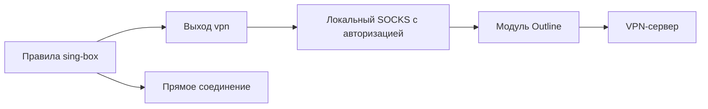

# Дополнительные модули

Модули расширяют возможности FlowVPN и доступны всем профилям. Управление находится в **Настройки → Модули**: установка, проверка состояния, восстановление и удаление. Установка показывает общий прогресс внизу окна; переход на другую страницу её не прерывает. Загрузку можно отменить и повторить.

Сейчас предусмотрен один модуль — **Совместимость Outline**. Go, Outline Client и другие инструменты на компьютере пользователя не нужны.

## Ключи Outline с префиксом

Некоторые ключи маскируют начало TCP-соединения с помощью `prefix`. Sing-box не реализует этот параметр; FlowVPN сохраняет его и использует отдельный транспорт на основе официального Outline SDK. Поддерживаются статические ключи `ss://` и обычный JSON Shadowsocks, в том числе полученный по динамическому `ssconf://`.

После добавления такого подключения приложение предлагает установить модуль. Отказ не удаляет подключение: вернуться к установке можно позже. Динамический ключ проверяется заново перед подключением; предложение установки использует уже полученные параметры и не требует повторной загрузки ключа.

Поддерживаемые методы: `aes-128-gcm`, `aes-256-gcm`, `chacha20-ietf-poly1305`. Префикс применяется к TCP; UDP использует обычный Shadowsocks, как в соответствующих форматах Outline. Символы U+0000–U+00FF обозначают отдельные байты. FlowVPN оставляет не менее восьми случайных байтов соли: максимум 8 байт префикса для AES-128 и 16 для остальных двух методов. Неподдерживаемые параметры отклоняются; обрезания или удаления префикса нет.

Расширенные конфигурации `transport`, плагины и префикс для Shadowsocks 2022 этим модулем не поддерживаются.

## Маршрутизация

Маршрут выбирает sing-box по прежним правилам: общая база, локальная сеть, дополнительные домены и режим приложений. Модуль заменяет только транспорт выхода `vpn`:

Физический интерфейс выбирается до запуска TUN; внешние сокеты модуля привязаны к нему. Соединение sing-box с модулем привязано к loopback. Эти привязки предотвращают повторное попадание транспортного соединения в туннель.

Модуль запускается только на время нужного подключения и без повышения прав. Удаление используемого модуля недоступно. При аварии модуля FlowVPN останавливает VPN; перехода на обычный Shadowsocks или `direct` вместо требуемого транспорта нет. После остановки TUN системная сеть восстанавливается — это не общесистемный kill switch.

## Доверие и обновления

`modules.lock.json` встроен в приложение и фиксирует версию, точный URL выпуска, размер, SHA-256, архитектуру и версию протокола. Модуль скачивается отдельно с GitHub Releases этого репозитория. Перед размещением проверяются размер и хеш; перед запуском файл проверяется снова и удерживается открытым вместе с каталогами на время сеанса. Текущий каталог нельзя заменить внешним JSON.

Модуль получает параметры по анонимному каналу стандартного ввода. Пароли не передаются через аргументы процесса и не сохраняются в открытом временном конфиге. Локальный SOCKS требует случайные учётные данные; UDP связан с авторизованной TCP-сессией и владельцем процесса. Дочерний процесс ограничен Windows Job Object.

Новая доверенная версия модуля допускается обновлением FlowVPN после проверки совместимости. Интерфейс каталога отделён от установки и транспорта; будущий сервер каталога не должен получать право разрешать произвольный исполняемый файл без отдельной схемы доверия.

## Проверки и ограничения

Автоматические проверки используют синтетические ключи и локальный сервер. Проверяются TCP/UDP, фактический префикс, авторизация, принадлежность UDP, завершение процессов, совместимость с закреплённым sing-box без TUN, отмена загрузки, подмена файла и ограничения удаления. Сравнение конфигураций проверяет неизменность правил маршрутизации и DNS во всех трёх режимах, с включённой и выключенной базой.

Эти проверки не заменяют испытание реального VPN, установки и обновления MSIX на чистой Windows. Сведения о ручной проверке должны публиковаться отдельно от результатов тестов.

Исходники, протокол и инструкции сборки: [modules/outline-transport](../modules/outline-transport/README.md).

Первичные источники: [префиксы Outline](https://developer.getoutline.org/vpn/advanced/prefixing/), [Outline SDK](https://github.com/OutlineFoundation/outline-sdk), [обсуждение поддержки в sing-box](https://github.com/SagerNet/sing-box/issues/3230).
